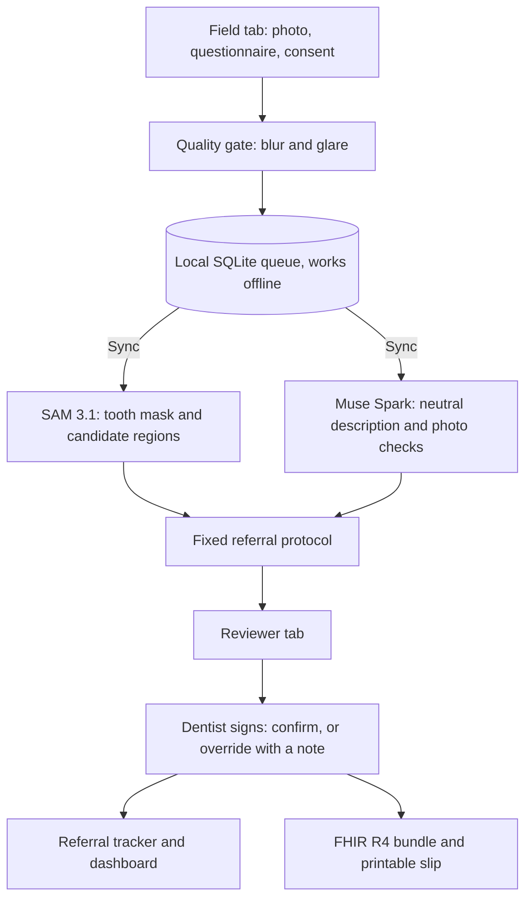

# OncoLens

**A photo documentation and referral routing workflow for oral lesions that works offline.** A health worker photographs the mouth and answers a short questionnaire. A **fixed clinical protocol** sets the referral priority. SAM 3.1 and Muse Spark help the dentist review the photo. A dentist signs every case. **OncoLens does not diagnose and gives no medical advice.**

| | |
|---|---|
| **Hackathon** | Meta Global AI Developer Hackathon, Indie Developer track |
| **Theme** | Build for Your World |
| **Built during the hackathon** | Oct 26 to Nov 4, 2026. Everything in this repo was written during the event. |
| **Demo video (3 min)** | [<<VIDEO_URL>>](https://youtu.be/wd1wJXia3A4?si=smbHFsAMe6dIQlGH) |

> Prototype for demonstration. Not a medical device. Do not upload real patient photos.

---

## Stage 1 evidence: how Meta's models are used

Both models are called through the **Meta Model API**.

| Model | Where in the code | What it does here |
|---|---|---|
| **SAM 3.1** (`sam-3.1`) | `core/segment.py`, `core/manual_prompt.py` | Segments teeth (to remove dental false positives), proposes candidate lesion regions from text prompts, and outlines the lesion at a **point the dentist clicks** |
| **Muse Spark** (`muse-spark-1.1`) | `core/reason.py` | Describes the photo in neutral words, checks that it is an intraoral photo, flags unusable photos, and flags a mismatch between the photo and the site written on the form. It is **not** allowed to set priority, interpret findings or give advice. |

**Theme fit (Build for Your World):** I live in India, and the most common problem I see everywhere is people using tobacco products and then suffering from illness. I wondered whether anything could be done earlier, and that is how I came to build OncoLens.

---

## The problem

Oral cancer is a major burden in India. Lip and oral cavity cancers made up about 10.2% of new cancers in 2022 (143,759 cases, GLOBOCAN 2022; [ecancermedicalscience analysis](https://ecancer.org/en/journal/article/2162-oral-cancer-burden-and-mortality-in-india-a-globocan-2022-analysis-with-regional-comparison)). Many of these cancers begin as visible changes in the mouth, so the first person to see the patient matters: the health worker in the village.

Frontline workers (ASHA/ANM) see patients first, specialists are far away, and referrals get lost. OncoLens documents the case consistently, routes it by a transparent protocol, and tracks whether the referral was completed.

---

## What it does

1. **Field tab:** photo capture or upload, an instant **quality gate** (blur and glare), a questionnaire, required **consent**, and a **local queue** that works offline.
2. **Sync:** SAM 3.1 and Muse Spark process each queued case.
3. **Reviewer tab:** the original photo beside candidate regions (tick or untick each, or **point SAM at the lesion**), a neutral photo description, and a memo and patient message built from fixed templates in **English and Hindi**. There is a WhatsApp share of the text message, and the dentist signs off.
4. **Referral tracker and dashboard:** due dates, overdue referrals, counts by priority.
5. **Exports:** a **FHIR R4 Bundle** and a printable HTML slip.
6. **Safety and Evidence tab:** a live run of the protocol test scenarios, the rules in force, evaluation results and limitations.



---

## Safety design

- **Priority comes only from a fixed protocol** applied to the questionnaire. No AI is involved in that step.
- **The AI only describes the photo.** Diagnostic, interpretive and advice wording is removed from its output automatically.
- **Next step and patient messages are fixed templates** (pending clinician approval; the Hindi text still needs review by native speakers for accuracy).
- **A dentist signs every case.** Lowering the priority below the protocol requires a written note.
- A photo that is not of the inside of a mouth is never routine and shows a retake banner. "No region found" never means normal.
- Consent is required, and an append only audit log records key actions (no patient data).

| Rule | Result |
|---|---|
| Duration unknown ("Not sure") | at least **priority** |
| Change lasting 2 weeks or more | at least **priority** |
| Any single warning sign | at least **priority** |
| Risk habit and no region found by SAM | at least **priority** |
| Warning sign with 3+ weeks, or two or more warning signs | **urgent** |
| Photo not of a mouth | at least **priority**, retake |

These thresholds are a prototype policy and need clinician approval.

---

## Limitations

- SAM 3.1 may miss diffuse lesions that have no clear border. That is why the reviewer can point at the lesion.
- Lesion area is relative (% of the image), not millimetres.
- Small test set. No clinical validation.
- Protocol thresholds and message templates need clinician approval, and the Hindi text needs review by a native speaker.
- The FHIR export follows the R4 structure and carries no diagnosis codes. It is not ABDM certified.
- If deployed, all visitors share one database, so a public demo should run in demo mode (sample photos only).

---

## Built during the hackathon

Everything in this repository was written between Oct 26 and Nov 4, 2026. No code from earlier projects was reused.

---

## Run it yourself

```bash
python -m venv .venv
# Windows: .venv\Scripts\activate      Mac/Linux: source .venv/bin/activate
pip install -r requirements.txt
# create .env with:  MODEL_API_KEY=your_meta_model_api_key
streamlit run app.py
```

- Demo mode (sample photos only, no uploads, no wipe button): set `DEMO_MODE=1`.
- Use a standard Muse Spark model (not a contributor model) for any clinical image. The code refuses contributor models.
- Tests: `python -m tests.test_safety`, `python -m tests.test_fhir`, `python -m tests.test_segmenter`, `python -m tests.eval_smartom data/eval_smartom`.
- Recommended Python: 3.11 or 3.12.

```text
app.py                 Streamlit UI (Field, Reviewer, Dashboard, Safety and Evidence)
pipeline.py            process_case(): quality gate, SAM, Muse Spark, protocol
core/segment.py        SAM 3.1 wrapper, tooth filter, overlays
core/manual_prompt.py  Reviewer point prompt
core/reason.py         Muse Spark: neutral photo description and checks
core/safety.py         Referral protocol, templates, wording guard
core/store.py          SQLite queue, referral tracker, audit log
core/fhir_export.py    FHIR R4 bundle        core/slip.py   Printable slip
tests/, tools/         Tests, evaluation, dataset helpers
```

---

## Image data attribution

Demo images and the expert annotations used for evaluation come from **SMART-OM**, licensed **CC BY 4.0** (https://creativecommons.org/licenses/by/4.0/).

P D, Dr Madan Kumar; K, Dr Ranganathan; S, Dr Rajeshwari; Pavithra, Dr. M; Lavanya C, Dr; Nayak, Anwesh; et al. (2026). *SMART-OM: A SMARTphone based expert annotated dataset of Oral Mucosa images.* figshare. Dataset. https://doi.org/10.6084/m9.figshare.31341790.v1

Companion paper: "A Smartphone-based Comprehensive Dataset of Annotated Oral Cavity Images for Enhanced Oral Disease Diagnosis", *Scientific Data* (2026), https://doi.org/10.1038/s41597-026-06954-5

Images are copied unmodified. OncoLens resizes them for analysis and draws overlays. Images in `data/demo_controls/` are modified copies (blurred or with added glare) used to demonstrate the quality gate. The images were not used to train or fine tune any model. The dataset authors have not endorsed OncoLens.

---

## Disclaimer

OncoLens is a research prototype for documentation and referral routing. It does not diagnose any condition, does not give medical advice, and must not be used for patient care. A licensed clinician must examine every patient.

Code licence: MIT, see the [LICENSE](LICENSE) file.
